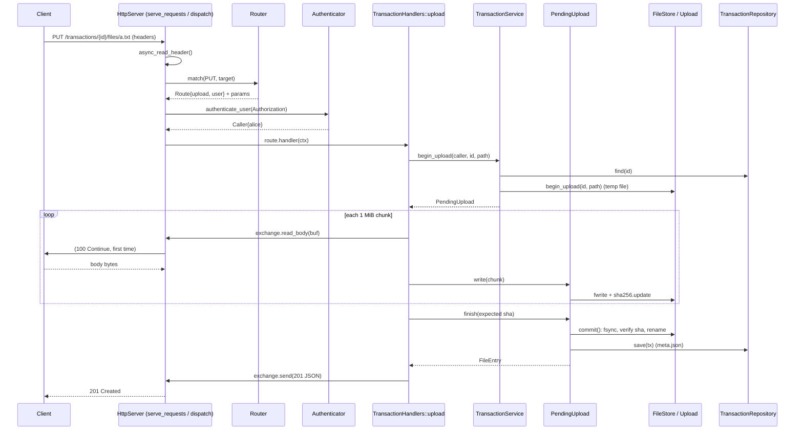

# Current Architecture (as implemented)

This document describes how the code works **today**: which function calls
which, from process start to a byte landing on disk and the response going
back. For the target design see [Architecture.md](Architecture.md).

Not implemented yet: the forwarder (`ServiceOptions::on_committed` is empty,
so committed remote transactions stay `committed`) and the retention job
(`list_expired()` / `expire()` exist but nothing calls them).

---

## 1. Layers

```
┌──────────────────────────────────────────────────────────────────────┐
│ app/main/main.cpp         wiring, signals                            │
├──────────────────────────────────────────────────────────────────────┤
│ api/server.cpp            HttpServer: sockets, TLS, HTTP parsing,    │
│                           SessionExchange (implements api::Exchange) │
│ api/router.cpp            Router: method + path -> Route             │
│ api/handlers.cpp          TransactionHandlers: HTTP <-> service      │
│ api/auth_handlers.cpp     AuthHandlers: POST/DELETE /auth/token      │
│ api/json.cpp, http.cpp    JSON decode/encode, ErrCode -> HTTP status │
├──────────────────────────────────────────────────────────────────────┤
│ auth/authenticator.cpp    Basic / user token / peer token checks     │
│ auth/session_store.cpp    user tokens (in memory, SHA-256 keyed)     │
│ auth/login_limiter.cpp    backoff on wrong passwords (429)           │
│ auth/user_directory.cpp   IUserDirectory factory:                    │
│   local_directory.cpp       users/groups from config (PBKDF2)        │
│   ldap_directory.cpp        users/groups from LDAP (WITH_LDAP only)  │
│ ldapclient/               LDAP bind + search (for ldap_directory)    │
├──────────────────────────────────────────────────────────────────────┤
│ transaction/service.cpp   TransactionService: access rules, state    │
│                           machine, per-transaction locks, biz log    │
│ transaction/repository.cpp  in-memory index + meta.json persistence  │
│ transaction/codec.cpp     meta.json / manifest.json encode/decode    │
│ transaction/state_machine.cpp  allowed state transitions             │
├──────────────────────────────────────────────────────────────────────┤
│ storage/storage.cpp       FileStore, Upload, Download (disk I/O)     │
├──────────────────────────────────────────────────────────────────────┤
│ common/ logging/ config/  errors, ids, paths, sha256, base64, logs,  │
│                           TOML                                       │
└──────────────────────────────────────────────────────────────────────┘
```

Each layer only calls the layer below it. `api` never touches `storage`
directly except through the `storage::Download` / `PendingUpload` objects that
the service hands out.

### Error model

Every fallible function returns `common::Result<T>` = `std::expected<T, Error>`
([common/error.hpp](src/lib/common/error.hpp)). `CFD_TRY(var, expr)` /
`CFD_TRYV(expr)` work like Rust's `?`: on error they return early with the
same `Error`. Errors bubble up unchanged to the handler, which turns
`Error::code` into an HTTP status with `status_for()`
([api/http.cpp](src/lib/api/http.cpp)):

| ErrCode | HTTP |
|---|---|
| validation | 400 |
| auth | 401 |
| forbidden | 403 (handlers send **404** instead, so ids can't be probed) |
| notfound | 404 |
| conflict | 409 (the router uses it for **405** method not allowed) |
| gone | 410 |
| integrity, unknown_destination | 422 |
| unavailable | 503 (also: LDAP unreachable) |
| throttled | 429 (too many wrong passwords, see §4.3) |
| io, internal | 500 |

Error body: `{"error":"<code>","detail":"..."}` (`error_body()`).

---

## 2. Startup

[app/main/main.cpp](src/app/main/main.cpp)

```
main(argc, argv)
├── -h/--help -> usage;  -v/--version -> version::kProjectVersionString
├── config::ConfigLoader::from_file(path)          -> config::Config
│     merges auth.users_file + [[user]], auth.groups_file + [[group]]
├── fs::create_directories(log dir)
├── logging::TechLog(FileSink "technical.log")
├── logging::BusinessLog(FileSink "business.log", SystemClock)
├── tlog: "starting" with version; every cfg.warnings() entry as a warning
└── serve(cfg, clock, tlog, blog)
    ├── storage::FileStore::open(storage.root)
    │     creates <root>/transactions, wipes and recreates <root>/tmp
    ├── auth::make_directory(cfg, &tlog)                  -> unique_ptr<IUserDirectory>
    │     auth.provider = "local": LocalDirectory::create(cfg)
    │                              parses every user's password_hash (fails startup if bad)
    │     auth.provider = "ldap":  make_ldap_directory(cfg.auth().ldap)
    │                              (`validation` in a build without WITH_LDAP)
    ├── transaction::TransactionRepository repo(store)
    ├── repo.load()
    │     store.list_transactions()          -> ids of folders
    │     for each id: store.read_document(id, meta) -> decode_meta()
    │     fills the in-memory index_ (unordered_map<id, Transaction>)
    ├── transaction::TransactionService service(repo, store, blog, clock, ServiceOptions{
    │       local_server, default_retention_days, max_retention_days,
    │       check_destination = destination_check(cfg, directory),  // FR-13 lambda
    │       is_recipient = directory.is_member(user, target),       // group targets
    │       on_committed = {} })                                    // forwarder TODO
    ├── api::TransactionHandlers handlers(service, blog, tlog)
    ├── api::Router router
    ├── handlers.register_routes(router)                  // see §3
    ├── auth::Authenticator::create(cfg, directory, clock)
    │     SHA-256 of every peer accept_token,
    │     SessionStore{token_ttl_s, token_idle_s}, LoginLimiter{defaults}
    ├── HeaderAuthenticator authenticator(...)            // adapter, see §4.3
    ├── api::AuthHandlers auth_handlers(authenticator, tlog)
    ├── auth_handlers.register_routes(router)             // /auth/token, see §3
    ├── api::ServerOptions::from_config(cfg)              // + make_tls_context() if TLS
    ├── api::HttpServer server(options, router, authenticator, tlog)
    ├── signal_set(SIGINT, SIGTERM).async_wait(-> server.stop())
    ├── server.start()                                    // see §4.1
    ├── no TLS -> tlog.warn("passwords travel unencrypted")
    ├── signal_io.run()        // blocks main thread until a signal
    └── server.wait()          // joins the server's worker threads
```

`destination_check` (FR-13): a local target must be a user **or a group**
known to the directory (`has_user` / `has_group`); a remote target must be a
configured peer.

---

## 3. Routes

Registered in `TransactionHandlers::register_routes()`
([api/handlers.cpp](src/lib/api/handlers.cpp)). Each `Def` becomes a
`Route{method, pattern, access, handler}`; the handler is a lambda that calls
the member function: `[this, fn](RequestContext& ctx) { return (this->*fn)(ctx); }`.

| Method | Pattern | Access | Handler | Service call |
|---|---|---|---|---|
| POST | `/transactions` | user | `create` | `service.create` |
| GET | `/transactions?box=in\|out` | user | `list` | `service.list` |
| GET | `/transactions/{id}` | user | `get` | `service.get` |
| POST | `/transactions/{id}/commit` | user | `commit` | `service.commit` |
| GET | `/transactions/{id}/files` | user | `list_files` | `service.get` |
| PUT | `/transactions/{id}/files/{path*}` | user | `upload` | `service.begin_upload` → `PendingUpload` |
| GET | `/transactions/{id}/files/{path*}` | user | `download` | `service.open_download` + `service.get` |
| DELETE | `/transactions/{id}/files/{path*}` | user | `remove_file` | `service.remove_file` |
| POST | `/internal/transactions` | peer | `receive` | `service.receive` |
| PUT | `/internal/transactions/{id}/files/{path*}` | peer | `upload` | (same as user upload) |
| POST | `/internal/transactions/{id}/commit` | peer | `commit` | (same as user commit) |
| POST | `/auth/token` | password | `AuthHandlers::login` | `auth.issue_token` |
| DELETE | `/auth/token` | user | `AuthHandlers::logout` | `auth.revoke_token` |

`{name}` matches one path segment, `{name*}` matches the rest including `/`.

`Access` ([api/router.hpp](src/lib/api/router.hpp)) says which credentials
the server accepts before the handler runs:

| Access | Authorization header |
|---|---|
| `user` | `Basic base64(user:pass)` **or** `Bearer ftu_<token>` |
| `password` | `Basic` only (a token must not buy a new token) |
| `peer` | `Bearer <peer accept_token>`; user tokens are refused |

---

## 4. Request lifecycle (common to every request)

### 4.1 Threads and coroutines

[api/server.cpp](src/lib/api/server.cpp)

```
HttpServer::start()
├── make_address(bind), acceptor.open/set_option/bind/listen
├── co_spawn(acceptor strand, Impl::accept_loop())
└── N threads, each running ioc.run()        // N = rest.threads or hardware_concurrency

Impl::accept_loop()                           // coroutine, runs forever
└── loop: co_await acceptor.async_accept(make_strand(ioc))
          co_spawn(socket's strand, Impl::serve(socket))   // one coroutine per connection
```

There is one `io_context` shared by all threads. Each connection has its own
**strand**, so one connection's code never runs on two threads at once, but
different connections run in parallel.

All handler code runs on those threads. Service and storage calls are
**synchronous** (blocking file I/O inside a coroutine). Only network reads and
writes are `co_await`ed.

### 4.2 Per connection

```
Impl::serve(socket)
├── beast::tcp_stream stream(socket)
├── track(stream)                           // registered so stop() can close it
├── plain HTTP:  serve_requests(stream)
│   TLS:         ssl::stream tls(stream, ctx)
│                co_await tls.async_handshake(server)
│                serve_requests(tls)
│                co_await tls.async_shutdown()
└── forget(conn)

Impl::serve_requests(stream)                // keep-alive loop
└── loop:
    ├── Parser parser                       // http::request_parser<buffer_body>
    │     header_limit = max_header_bytes, body_limit = max_upload_bytes
    ├── co_await http::async_read_header(stream, buffer, parser)
    │     ── reads ONLY the request line + headers, not the body
    │     eof           -> return (client closed)
    │     header_limit  -> write_response(413) and return
    │     timeout       -> return
    │     other error   -> write_response(400) and return
    ├── SessionExchange ex(stream, buffer, parser, options)
    ├── co_await dispatch(ex)
    └── if ex.must_close(): return          // client said close, error, or body not fully read
```

### 4.3 Dispatch: routing, authentication, handler

```
Impl::dispatch(ex)
├── req = ex.request()                      // parsed header (http::request_header<>)
├── router.match(req.method(), sv(req.target()))
│   ├── split target at '?'
│   ├── split_path(path) + url_decode() each segment
│   ├── for each Entry: match_segments(entry.segments, segments)
│   │     path matches and method matches -> parse_query() -> Match{route, params, query}
│   ├── path matched for another method only -> Error conflict   -> 405
│   └── nothing matched                        -> Error notfound -> 404
├── on error: ex.send(Response::error(...)), return
│
├── source = ex.remote_address()             // client IP, for the LoginLimiter
├── switch route.access:
│     peer     -> auth.authenticate_peer(req)
│     password -> auth.authenticate_password(req, source)
│     user     -> auth.authenticate_user(req, source)
│   │
│   │  HeaderAuthenticator (main.cpp) reads the Authorization header and calls
│   │  auth::Authenticator ([auth/authenticator.cpp]):
│   │
│   ├── authenticate_user(header, source)
│   │     "Bearer ..." -> SessionStore::verify(token)        // see below
│   │     otherwise    -> authenticate_password(header, source)
│   │
│   ├── authenticate_password("Basic base64(user:pass)", source)
│   │     credentials(header, "Basic") -> base64_decode -> split at first ':'
│   │     LoginLimiter::check(user, source)     -> 429 throttled, directory not asked
│   │     directory.verify(user, password)
│   │       LocalDirectory: unknown user -> dummy hash verify (same timing)
│   │                       fingerprint = SHA-256(salt || password)
│   │                       cache hit -> ok; else PasswordHash::verify() (PBKDF2), cache it
│   │       LdapDirectory:  cached bind (SHA-256 fingerprint, cache_ttl_s) -> ok
│   │                       else ldapclient authenticate (bind + group search),
│   │                       caches bind and groups; LDAP down -> 503 unavailable
│   │     ok   -> LoginLimiter::succeeded(user, source)
│   │     auth -> LoginLimiter::failed(user, source)
│   │     -> Caller{name as the directory spells it, is_peer=false}
│   │
│   └── authenticate_peer("Bearer <token>")
│         token starting with "ftu_" -> 401 (user tokens never accepted here)
│         SHA-256(token), constant-time compare against every peer (no early exit)
│         -> Caller{name = peer name, is_peer=true}
│
├── on error: throttled -> tlog.warn(method, target, source, detail)
│             ex.send(error; 401 adds WWW-Authenticate: Basic / Bearer), return
│
├── RequestContext ctx{ex, caller, params, query}
├── try { co_await route.handler(ctx) }      // -> TransactionHandlers::<fn>(ctx)
│   catch (std::exception) { log }
└── if the handler threw or sent nothing: tlog.error + ex.send(500)
```

**User tokens** — `auth::SessionStore`
([auth/session_store.cpp](src/lib/auth/session_store.cpp)), one mutex:

- `issue(user)`: 32 bytes from `RAND_bytes` → token `"ftu_" + 64 hex`.
  Only `SHA-256(token)` is stored as the map key, with `{user, created,
  last_used, expires_at = now + token_ttl_s}`. Expired sessions are swept
  here (no timer); past `max_per_user` (20) the user's oldest session is
  dropped.
- `verify(token)`: must start with `ftu_`; looked up by digest; expired if
  past `expires_at` **or** unused for `token_idle_s` → erased, 401.
  Otherwise `last_used = now` (sliding idle timeout) → user name.
- `revoke(token)`: erases the digest. Unknown tokens are ignored.
- In memory only: a restart logs everybody out.

**Password guessing** — `auth::LoginLimiter`
([auth/login_limiter.cpp](src/lib/auth/login_limiter.cpp)), one mutex.
Three counters per failure, user names lowercased:

| Key | Free failures | Stops |
|---|---|---|
| `p:<user>:<ip>` | 5 | one user mistyping |
| `s:<ip>` | 20 | one address trying many names |
| `u:<user>` | 50 | many addresses trying one name |

Past the free count, each failure blocks the key for `30 s × 2^n`, capped
at 900 s. `check()` refuses (429, `retry in N s`) while any of the three
keys is blocked, so the directory (and LDAP's own lockout) never sees the
attempt. `succeeded()` clears the pair and user keys but not the address
key. Idle keys are pruned when the table passes 10 000 entries. Only
Basic credentials go through the limiter; tokens do not.

### 4.4 Exchange: how handlers talk to the socket

Handlers never see the socket. They use `api::Exchange`
([api/http.hpp](src/lib/api/http.hpp)), implemented by
`SessionExchange<Stream>` in server.cpp (and by a fake in tests).

| Method | What it does |
|---|---|
| `request()` | the parsed header |
| `remote_address()` | client IP (`SessionExchange` only, used by `dispatch` for the LoginLimiter) |
| `read_body(buf)` | sends `100 Continue` if the client asked (`send_continue()`), then `co_await http::async_read(stream, buffer, parser)` with the parser's body pointed at `buf`. Returns bytes read, 0 at end of body. Body is never fully in memory. |
| `read_body_string(max)` | loops `read_body()` into a `std::string` (for JSON bodies), rejects > max |
| `send(Response)` | `write_response()`: builds `http::response<string_body>`, sets `Server`, `Content-Type`, keep-alive, `co_await http::async_write` |
| `send_file(Download&, sha256)` | writes header (`application/octet-stream`, `Content-Length`, `X-Checksum-SHA256`) with `async_write_header`, then loops `file.read(1 MiB)` → `async_write` chunk |
| `responded()` | true once `send` / `send_file` started |

Keep-alive is kept only if the client wants it **and** the body was fully
read; otherwise the leftover body bytes would be parsed as the next request.

### 4.5 Error path inside a handler

Every handler step that can fail does:

```cpp
if (!x) co_return co_await fail(ctx, x.error());
```

`TransactionHandlers::fail(ctx, err)`:
1. if a response was already started, do nothing;
2. if the status would be 500, write the error with file:line to the tech log;
3. `forbidden` is sent as `404 "no such transaction"`;
4. otherwise `ctx.exchange.send(Response::error(err))`.

---

## 5. Per-endpoint chains

Notation: `→` = calls. All `service_` methods are in
[transaction/service.cpp](src/lib/transaction/service.cpp), `repo_` in
[transaction/repository.cpp](src/lib/transaction/repository.cpp), `store_` in
[storage/storage.cpp](src/lib/storage/storage.cpp).

### Shared building blocks

**Access rules** (service.cpp, anonymous namespace):
- `is_sender`: user (not peer), transaction created here, `caller.name == tx.sender`
- `is_target`: user, transaction is local (`target_server` empty), and
  `caller.name == tx.target_user` **or** `options_.is_recipient(caller.name,
  tx.target_user)` — i.e. the caller is a member of the target group
  (`IUserDirectory::is_member`; local groups or LDAP groups)
- `is_origin_peer`: peer, `caller.name == tx.origin_server`
- `may_write` = sender or origin peer
- `may_read` = sender, origin peer, or target once the state is no longer `open`

**State machine** ([transaction/state_machine.cpp](src/lib/transaction/state_machine.cpp)):

```
open ──► committed ──► delivered
  │          │             │
  └──────────┴─────────────┴──► expired
```
- `require_mutable(state)`: only `open` (else 409, or 410 if expired)
- `require_readable(state)`: `committed` or `delivered`
- `check_transition(from, to)`

**Per-transaction lock:** `service.lock_for(id)` returns a `shared_ptr<mutex>`
from `locks_` (guarded by `locks_mu_`). Every write operation holds it.
The repository also has its own `mu_` around `index_`.

**Persisting a transaction:** `repo.save(tx)` →
`store.write_document(id, meta, encode_meta(tx))` → `begin_write()` (temp
file in `tmp/`) → `Upload::write()` → `Upload::commit()` (fflush, fsync,
rename over `meta.json`) → update `index_`. So `meta.json` is always replaced
atomically.

### 5.1 POST /transactions (create)

```
TransactionHandlers::create(ctx)
├── co_await ctx.exchange.read_body_string(max_json_bytes)
├── decode_create(body)                                 api/json.cpp -> CreateRequest
├── service_.create(caller, req)
│   ├── reject peers, empty target_user, retention_days < 0 or > max_retention_days
│   ├── local target? (target_server empty or == local_server) -> target_server = ""
│   ├── options_.check_destination(target_user, target_server)   // main.cpp lambda
│   │     local: directory.has_user(user) || has_group(user)   remote: cfg.find_peer(server)
│   ├── common::expires_at(clock.now(), days)
│   ├── Transaction{id = TransactionId::generate(), state = open, ...}
│   ├── repo_.insert(tx)
│   │   ├── index_.contains(id) -> conflict
│   │   ├── store_.create_transaction(id)     mkdir transactions/<id>/ and files/
│   │   ├── store_.write_document(id, meta, encode_meta(tx))
│   │   │     on failure: store_.remove_transaction(id)
│   │   └── index_.emplace(id, tx)
│   └── blog_.record(tx_created)
└── ctx.exchange.send(201, encode_transaction(tx))
```

### 5.2 PUT /transactions/{id}/files/{path*} (upload)

```
TransactionHandlers::upload(ctx)
├── id_param(ctx)    -> TransactionId::parse(params["id"])
├── path_param(ctx)  -> RelativePath::parse(params["path"])     // rejects "..", absolute, etc.
├── optional header X-Checksum-SHA256 -> Sha256Digest::from_hex()
├── service_.begin_upload(caller, id, path)
│   ├── lock(id)
│   ├── repo_.find(id)                 -> 404
│   ├── may_write(caller, tx)          -> 403 (sent as 404)
│   ├── require_mutable(tx.state)      -> 409 / 410
│   ├── store_.begin_upload(id, path)
│   │     begin_write(): open tmp/<id>-<n>.part, create Sha256 hasher
│   │     -> storage::Upload
│   ├── return PendingUpload(service, id, caller, upload)
│   └── (lock released here: the body can take minutes)
│
├── loop:                                               // 1 MiB buffer
│   ├── n = co_await ctx.exchange.read_body(buf)        // network -> buf
│   ├── n == 0 -> break
│   └── pending->write(buf[0..n])
│         Upload::write(): fwrite to temp file + hasher.update()
│
├── pending->finish(expected)
│   ├── lock(id) again
│   ├── repo_.find(id), require_mutable(state)          // committed meanwhile? -> 409
│   ├── upload_.commit(expected)
│   │     Upload::finish(): fflush + fsync + fclose
│   │                       hasher.finish(); compare to expected -> 422 integrity
│   │                       create_directories(parent), check clashes -> 409
│   │                       rename(tmp, transactions/<id>/files/<path>)
│   │     -> StoredFile{path, size, sha256}
│   ├── upsert_file(tx.files, entry)                    // sorted by path, replaces same path
│   ├── repo_.save(tx)                                  // rewrites meta.json
│   └── blog_.record(file_added)
└── ctx.exchange.send(201, encode_file(entry))
```

If anything fails before `commit()`, the `Upload` destructor calls
`discard()`, which deletes the temp file. A file in `files/` is therefore
always complete.

### 5.3 DELETE /transactions/{id}/files/{path*}

```
TransactionHandlers::remove_file(ctx)
├── id_param, path_param
├── service_.remove_file(caller, id, path)
│   ├── lock(id); repo_.find; may_write; require_mutable
│   ├── find path in tx.files                     -> 404
│   ├── store_.remove_file(id, path)              unlink + remove empty parent dirs
│   ├── tx.files.erase(...); repo_.save(tx)
│   └── blog_.record(file_removed)
└── ctx.exchange.send(204)
```

### 5.4 POST /transactions/{id}/commit (also /internal/... for peers)

```
TransactionHandlers::commit(ctx)
├── id_param
├── service_.commit(caller, id)
│   ├── lock(id)
│   │   ├── repo_.find; may_write
│   │   ├── check_transition(state, committed)
│   │   ├── for each file: store_.hash_file(id, path)   // re-read and re-hash from disk
│   │   │     size or sha256 differs -> 422 integrity  (NFR-6)
│   │   ├── state = committed, committed_at = now
│   │   ├── repo_.save_manifest(tx)    -> write_document(manifest, encode_manifest(tx))
│   │   ├── repo_.save(tx)             -> meta.json
│   │   └── blog_.record(committed)    // or `received` when a peer commits
│   └── (unlocked) options_.on_committed(tx)   // empty for now; forwarder hook
└── ctx.exchange.send(200, encode_transaction(tx))
```

### 5.5 GET /transactions?box=in|out (list)

```
TransactionHandlers::list(ctx)
├── ctx.query_value("box")  default "in"   -> Box::in / Box::out, else 400
├── service_.list(caller, box)
│   ├── peers get an empty list
│   ├── repo_.find_if(pred)          // copies matching entries out of index_
│   │     out: is_sender
│   │     in:  is_target && state in {committed, delivered}
│   └── sort newest first
└── ctx.exchange.send(200, encode_transaction_list(txs))
```

No disk access: everything comes from the in-memory index. With LDAP,
`is_recipient` may ask the directory for the caller's groups (cached for
`cache_ttl_s`).

### 5.6 GET /transactions/{id} and GET /transactions/{id}/files

```
TransactionHandlers::get / list_files(ctx)
├── id_param
├── service_.get(caller, id)
│   ├── repo_.find(id)       -> 404
│   └── may_read             -> 403 (sent as 404)
└── ctx.exchange.send(200, encode_transaction(tx))  /  encode_files(tx.files)
```

### 5.7 GET /transactions/{id}/files/{path*} (download)

```
TransactionHandlers::download(ctx)
├── id_param, path_param
├── service_.open_download(caller, id, path)
│   ├── repo_.find; may_read
│   ├── require_readable(state)       // open -> 409, expired -> 410
│   ├── tx.find_file(path)            -> 404
│   └── store_.open_read(id, path)
│         stat() + fopen("rb") -> storage::Download{file, size}
├── service_.get(caller, id)          // to get the stored sha256 for the header
├── tx.find_file(path)
├── co_await ctx.exchange.send_file(file, entry.sha256)
│     header: 200, octet-stream, Content-Length, X-Checksum-SHA256
│     loop: file.read(1 MiB) -> async_write chunk
│     on error after the header went out: close the connection (no error response possible)
└── blog_.record(downloaded)          // only after a complete send
```

### 5.8 POST /internal/transactions (peer pushes a transaction)

```
TransactionHandlers::receive(ctx)              // Access::peer, Bearer token already checked
├── co_await ctx.exchange.read_body_string(max_json_bytes)
├── decode_receive(body)                       -> ReceiveRequest{id, sender, target_user, created_at, expires_at}
├── service_.receive(peer, req)
│   ├── must be a peer; sender/target_user required; expires_at > created_at
│   ├── check_destination(target_user, "")    // target must be a local user
│   ├── lock(req.id)
│   ├── Transaction{id = req.id (same id as on the sender server),
│   │               origin_server = peer.name, target_server = "", state = open}
│   └── repo_.insert(tx)                       // 409 if the id already exists
└── ctx.exchange.send(201, encode_transaction(tx))
```

The peer then uploads files with `PUT /internal/transactions/{id}/files/...`
and commits with `POST /internal/transactions/{id}/commit`. These use the same
`upload` and `commit` handlers as above; `may_write` passes because
`is_origin_peer` is true. Commit logs `received` instead of `committed`.

### 5.9 POST /auth/token (login) and DELETE /auth/token (logout)

[api/auth_handlers.cpp](src/lib/api/auth_handlers.cpp)

```
AuthHandlers::login(ctx)                       // Access::password: Basic already checked
├── auth_.issue_token(ctx.caller.name)         // HeaderAuthenticator -> Authenticator
│     -> SessionStore::issue(user)             // see §4.3
├── tlog.info("token issued for <user>")
└── ctx.exchange.send(200, encode_token(token, user, expires_at),
                      Cache-Control: no-store)
      body: {"token":"ftu_...","user":"<canonical name>","expires_at":"<ISO 8601>"}

AuthHandlers::logout(ctx)                      // Access::user
├── auth_.revoke_token(request)                // only acts on a "Bearer ftu_..." header
│     -> SessionStore::revoke(token)
├── tlog.info("token revoked for <user>")
└── ctx.exchange.send(204)
```

Logout with Basic credentials is accepted and does nothing.

---

## 6. End-to-end sequence (upload example)



---

## 7. Data on disk

```
<storage.root>/
├── tmp/                               upload temp files (*.part), wiped on start
└── transactions/
    └── <transaction-id>/
        ├── meta.json                  full Transaction (codec: encode_meta)
        ├── manifest.json              written once on commit (encode_manifest)
        └── files/<relative/path>      payload
```

The in-memory `TransactionRepository::index_` is the read source for all
queries. `meta.json` is its durable copy, rewritten on every change and read
back only by `repo.load()` at startup.

---

## 8. Shutdown

```
SIGINT/SIGTERM -> signals handler (main.cpp) -> server.stop()
HttpServer::Impl::stop()
├── stopping = true
├── post(acceptor strand): acceptor.close()      -> accept_loop ends
└── for each tracked connection: post(conn strand): stream.close()
      -> pending reads/writes fail, coroutines finish, Upload destructors delete temp files
main: signal_io.run() returns -> server.wait() joins all threads -> return 0
```

---

## 9. Logs

- **Technical log** (`technical.log`, `logging::TechLog`): startup (with
  version), config warnings, the "TLS is off" warning, accept and TLS
  failures, 500 errors with source location, aborted downloads, throttled
  logins (method, target, client IP), tokens issued / revoked, and LDAP
  diagnostics (refused binds with the server's reason, unreachable server).
  The LDAP reason never reaches the client, which always sees
  `invalid user name or password`.
- **Business log** (`business.log`, `logging::BusinessLog::record(BizEvent)`):
  one event per business action: `tx_created`, `file_added`, `file_removed`,
  `committed`, `received`, `downloaded`, plus `forwarded` / `expired` from the
  not-yet-wired `mark_delivered()` / `expire()`.

---

## 10. Client (`ftc`)

[app/cli/main.cpp](src/app/cli/main.cpp),
[http_client.cpp](src/app/cli/http_client.cpp),
[token_cache.cpp](src/app/cli/token_cache.cpp). A separate executable; it
shares only `common` with the server.

```
main -> cmd_<command>(global, vm)
└── connect(global)                                // every command except login/logout
    ├── open_session(global)
    │   ├── --server / --user (or FTC_SERVER / FTC_USER) required
    │   ├── ServerUrl::parse(server)               // http[s]://host[:port], port 8080 by default
    │   ├── http:// without --allow-http -> refuse (before any password is asked)
    │   ├── TokenCache::for_server(url, user)
    │   │     $XDG_STATE_HOME/ftc/tokens/<user>@<host>_<port>  (~/.local/state if unset)
    │   └── HttpClient::create(url, ca_file)
    ├── cache.load()
    │     folder 0700 / file 0600; readable or replaceable by others -> refuse
    │     token found -> client.set_token(token)        // "Authorization: Bearer ftu_..."
    │     none        -> login(): read_password()       // FTC_PASSWORD, tty without echo, or stdin
    │                    client.login() = POST /auth/token with Basic
    │                    OPENSSL_cleanse(password); cache.save(token)  (temp file + rename)
    └── if a password can be asked (FTC_PASSWORD or stdin is a tty):
          client.on_expired(relogin = login() again)

HttpClient::<request>
└── with_relogin(attempt)
      attempt(); on `auth` (401) and relogin set -> new token, attempt() once more
```

- `ftc login`: always asks for the password and replaces the cached token.
- `ftc logout`: `DELETE /auth/token` with the cached token, then deletes the
  file even if the server could not be told (warns unless the server said
  401, i.e. the token was already gone).
- One TCP/TLS connection per request; no keep-alive state in the client.
